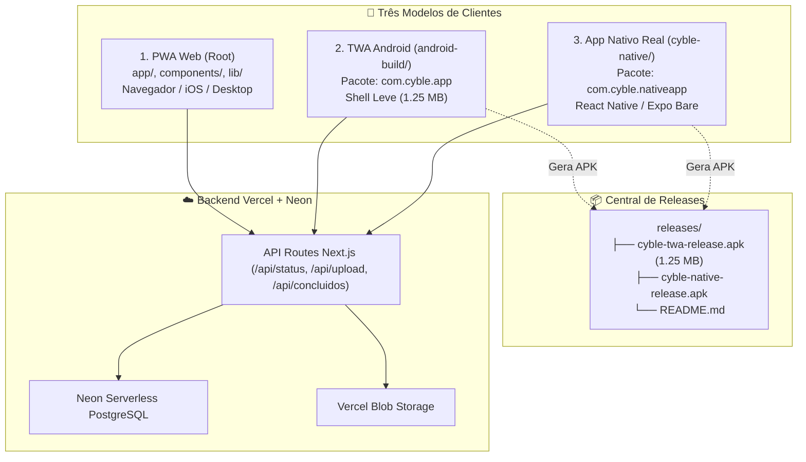

# ADR-003: Coexistência Tri-Plataforma (PWA + TWA + React Native) e Central de Releases

**Data:** 09/11/2026  
**Status:** Aprovado e Implementado  
**Autores:** Global Master Agent & Engenharia Cyble  

---

## 1. Contexto & Problema

O aplicativo **Vistoria Cyble** foi concebido originalmente como um PWA offline-first (Next.js 14 + IndexedDB v5). Com a evolução do projeto e necessidades identificadas em campo (garagens subterrâneas sem sinal de celular, caixas de hidrômetro escuras exigindo iluminação por lanterna e equipes técnicas operando com diferentes perfis de dispositivos), surgiu a demanda de empacotamento nativo (.apk) sem abrir mão da flexibilidade do PWA web.

Para evitar confusão no código-fonte e garantir integridade das operações em andamento, era imperativo:
1. Manter o PWA em produção na Vercel 100% inalterado e estável.
2. Manter a versão TWA (APK leve de 1.25 MB) disponível para atualização remota instantânea.
3. Criar uma aplicação Android nativa real com controle de hardware (lanterna/torch física) em uma pasta isolada.
4. Centralizar todos os instaláveis em um único diretório acessível (`releases/`).

---

## 2. Decisão Arquitetural: Separação em 3 Pilares

Adotamos a estratégia de **Três Pilares Isolados**, compartilhando um backend unificado:



---

## 3. Estrutura de Diretórios do Repositório

```
Vistoria-Cyble-App/
├── app/                  # [PWA] Next.js App Router (PWA Web)
├── components/           # [PWA] Componentes React da Web
├── lib/                  # [PWA] Lógica de negócio, IndexedDB v5 e exportações
├── public/               # [PWA] Service Worker v23 e manifesto PWA
├── android-build/        # [TWA] Projeto Android Studio Bubblewrap (com.cyble.app)
├── cyble-native/         # [NATIVO] Aplicativo React Native (com.cyble.nativeapp)
│   ├── src/
│   │   ├── api/          # Cliente HTTP com injeção de x-app-pin
│   │   ├── db/           # AsyncStorage e fila de sincronização
│   │   ├── screens/      # PinGate, Dashboard, Captura (Torch), SyncQueue
│   │   └── constants/    # Tema escuro #0C0F14
│   ├── android/          # Projeto Gradle nativo (Hermes, NDK)
│   ├── App.tsx           # Ponto de entrada do app nativo
│   └── package.json
└── releases/             # [RELEASES] Central oficial de arquivos .apk instaláveis
    ├── cyble-twa-release.apk
    └── README.md
```

---

## 4. Comparativo dos Modelos

| Recurso / Característica | PWA (Web) | TWA (APK Leve) | React Native (Nativo) |
| :--- | :---: | :---: | :---: |
| **Diretório** | `/` (Raiz) | `android-build/` | `cyble-native/` |
| **Package ID** | — | `com.cyble.app` | `com.cyble.nativeapp` |
| **Instalação lado a lado** | Sim (Atalho Web) | Sim | Sim (App independente) |
| **Tamanho do APK** | Zero (Web) | ~1.25 MB | ~30–45 MB |
| **Atualização** | Instantânea no browser | Instantânea (Deploy Vercel) | Requer novo APK |
| **Controle de Lanterna (Torch)** | Parcial (suporte de browser) | Parcial | **Total (Hardware nativo)** |
| **Banco Offline** | IndexedDB v5 | IndexedDB v5 | AsyncStorage / SQLite |
| **Upload Background** | Enquanto app aberto | Enquanto app aberto | WorkManager / Background |

---

## 5. Governança da Central de Releases

- **Regra Mandatória:** Nenhum arquivo instalável (.apk, .aab) deve ser deixado espalhado na raiz do repositório.
- **Localização:** Todo executável compilado DEVE ser copiado para `releases/` com nome explicativo (ex: `cyble-twa-release.apk`, `cyble-native-release.apk`).
- **Rastreamento Git:** O `.gitignore` possui exceção explícita (`!releases/*.apk`, `!releases/*.aab`) garantindo persistência dos instaláveis no controle de versão.
